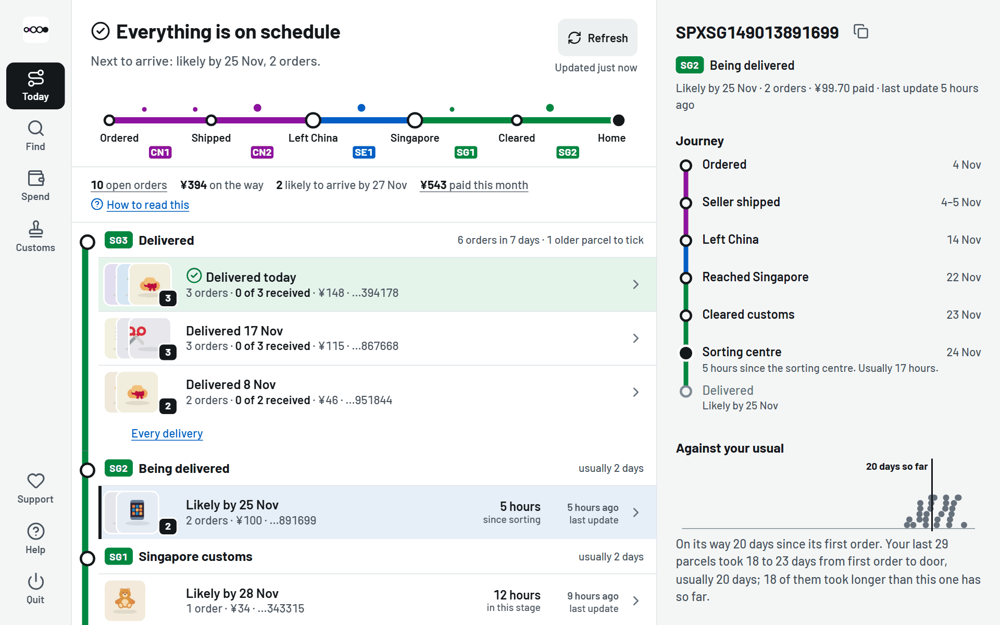
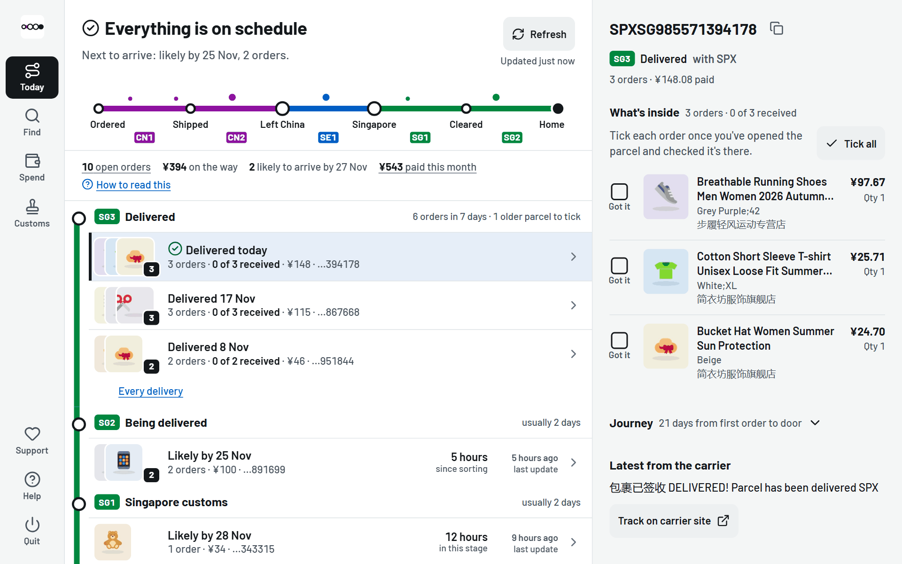
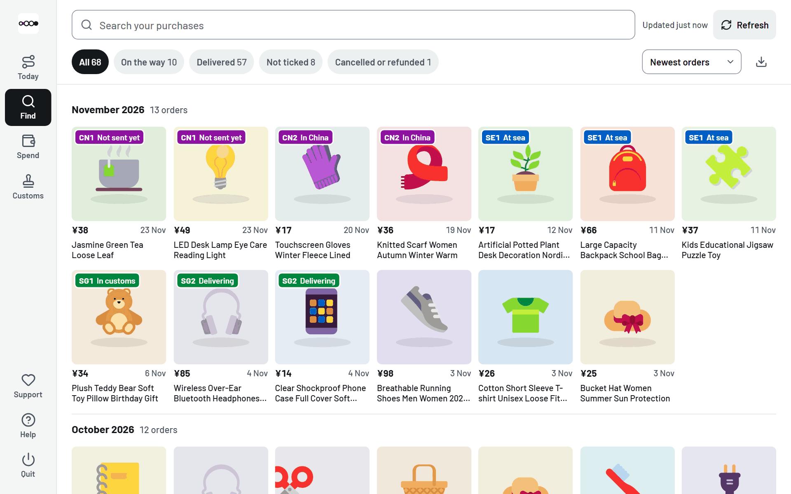
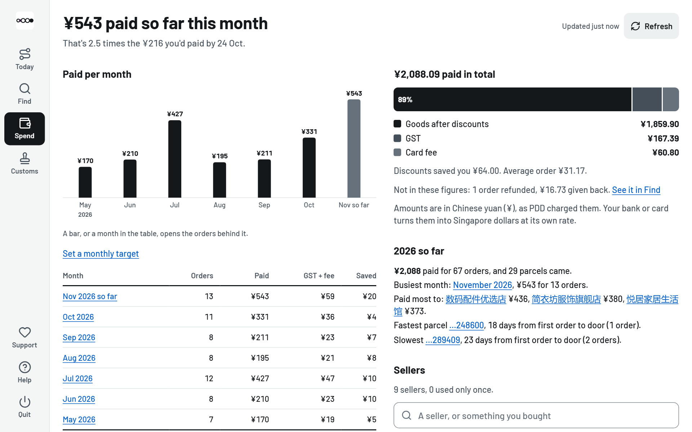
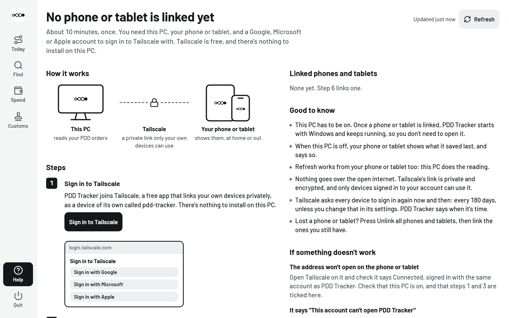
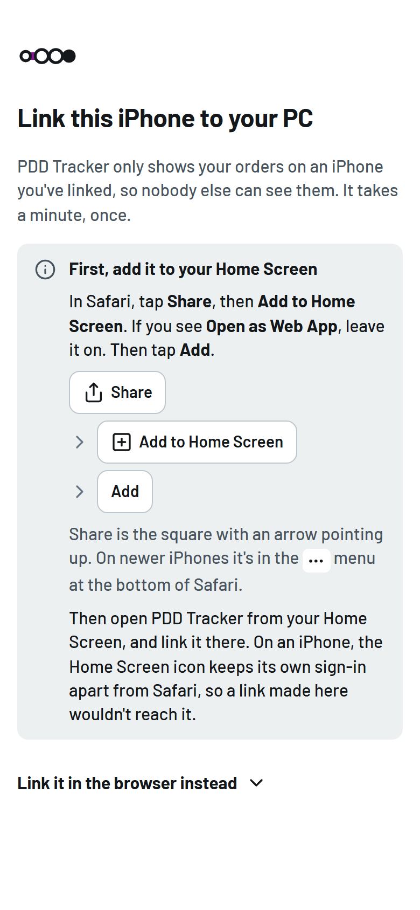

# PDD Tracker

PDD Tracker shows where your Pinduoduo parcels are on their way to Singapore.
It reads your orders from your own PDD account and keeps everything on your PC.
It's for Windows 11 (it may work on Windows 10, but hasn't been tried there).

**[Download the newest version](https://github.com/singaporesky/pdd-tracker/releases/latest/download/PDD-Tracker-Setup.exe)**,
or see [all releases](https://github.com/singaporesky/pdd-tracker/releases) for
how to install it, update it and check your download.

## What it looks like

**Today** shows every parcel on its way, closest to you first, and when it will
likely arrive.

Open a parcel to see where it has been, the carrier's newest update, and the
orders inside it to tick off once you've checked them. A delivered parcel
stays on Today for a week, and after that until every order in it is ticked.

**Find** shows everything you've bought as photos you can search.

**Spend** shows what you paid each month, to which sellers, and your year so far.

## On your phone or tablet

PDD Tracker can show your parcels on an iPhone, iPad (iOS 15 or later), or
Android phone or tablet, at home or out, over Tailscale, a free service that
links your own devices privately. Tailscale is built into PDD Tracker, so
there's nothing else to install on the PC: the phone or tablet just needs the
Tailscale app. On the PC, press **Help**, then **Set up a phone or tablet**,
and follow its six steps, each with a picture.

Each phone or tablet is linked once with a code shown on the PC, so nobody else
can see your orders, and each can be unlinked on its own. On an iPhone or iPad,
add it to the Home Screen first: it then opens like any other app, as **PDD
Tracker**.

These pictures come from a made-up account, not anyone's real orders.

## Good to know

This repository holds only the installer releases. PDD Tracker isn't made by or
connected with PDD or Pinduoduo; use it at your own risk.

If something doesn't work, [open an issue](https://github.com/singaporesky/pdd-tracker/issues).
Issues are public, so don't put order numbers, tracking numbers or screenshots
of your orders in one.
